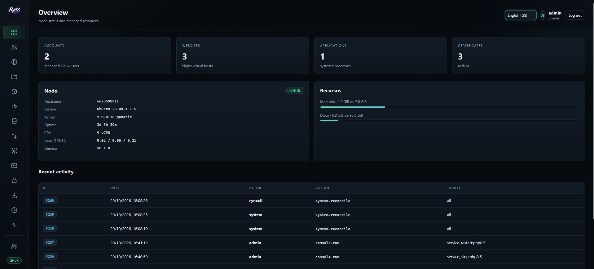
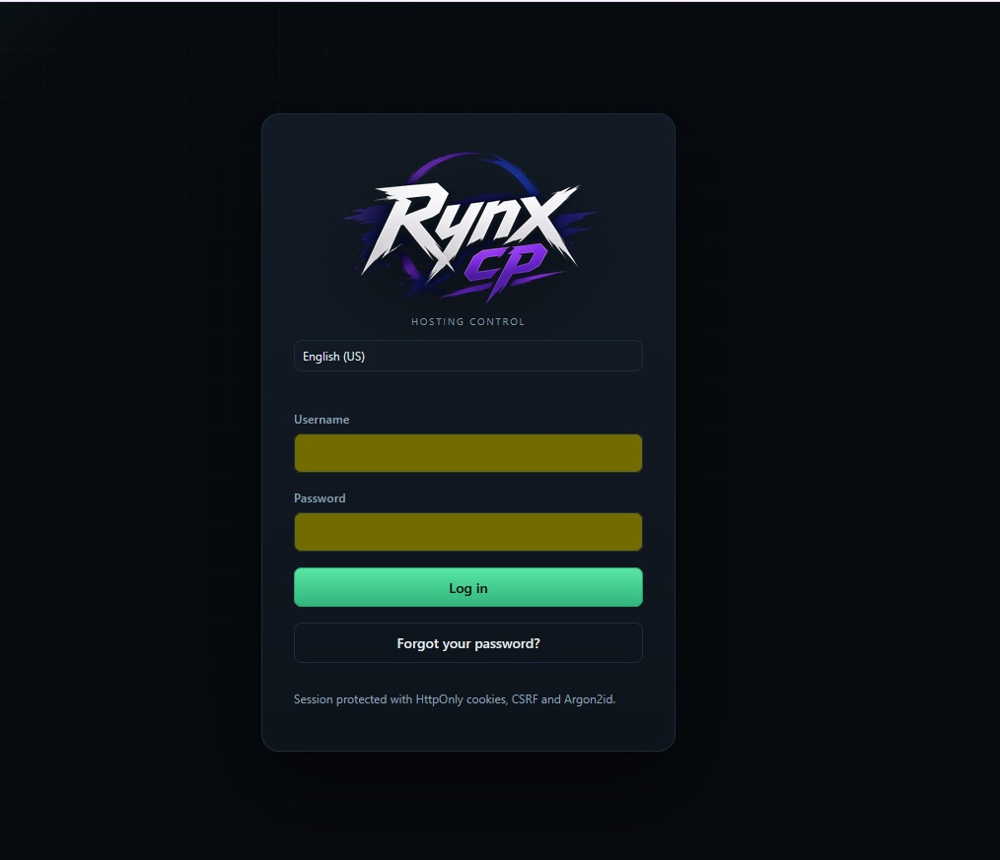
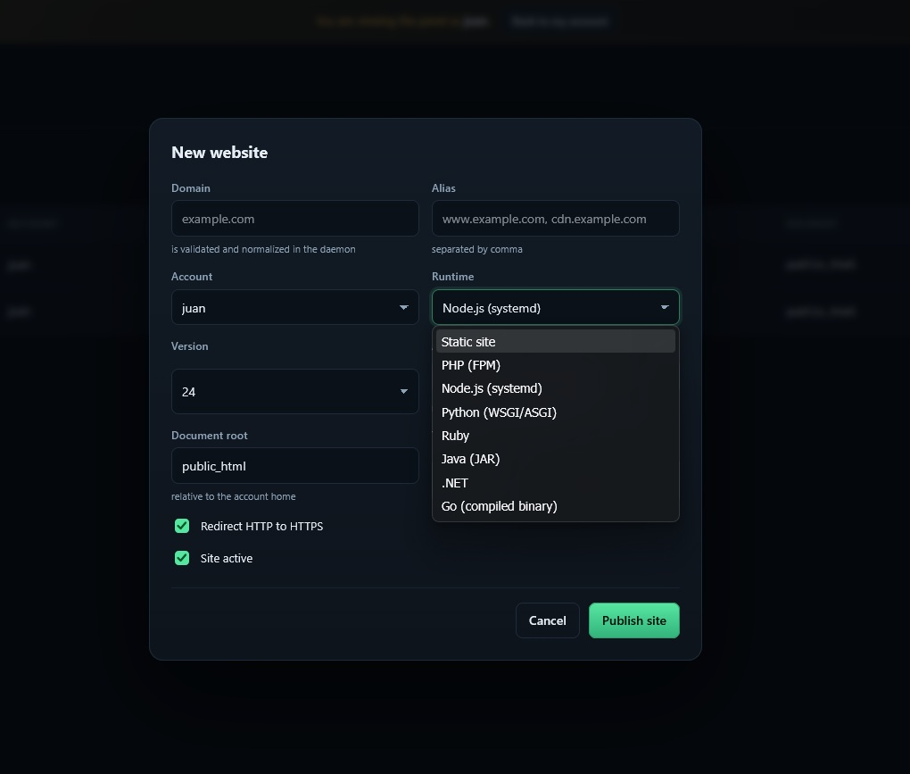
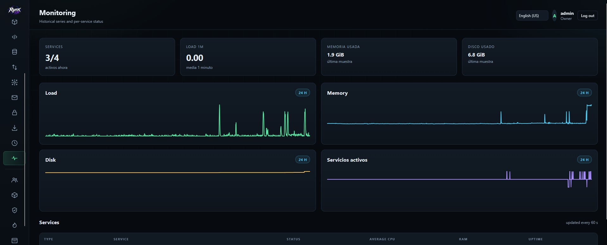

# RYNXCP

<p align="center">
  
</p>

A **from-scratch hosting control panel written in Rust** for Debian/Ubuntu VPS and
dedicated servers. It follows a declarative model: you describe the desired state
(accounts, sites, runtimes, DNS, databases, FTP, backups, firewall) and the daemon
reconciles the operating system towards it.

It is not a fork of cPanel, Plesk, HestiaCP or Vesta. The architecture, protocol,
reconciliation engine and UI are original.

## Screenshots

<p align="center">
  
  <br />
  <sub>Overview</sub>
</p>

<p align="center">
  
  <br />
  <sub>Login</sub>
</p>

<p align="center">
  
  <br />
  <sub>Websites</sub>
</p>

<p align="center">
  
  <br />
  <sub>Monitoring</sub>
</p>

## Features

| Area | What is included |
| --- | --- |
| Accounts | Isolated Linux users, package-assigned quota/backend, real suspension (Nginx/apps/FTP) and deletion |
| Web | Nginx virtual hosts, aliases, TLS, optional HTTP-to-HTTPS redirect, PHP-FPM, reverse proxy, security headers |
| Runtimes | PHP, Node.js, Python, Ruby, Java, .NET, Go and static sites |
| DNS | Authoritative BIND zones, A/AAAA/CNAME/MX/TXT/NS/SRV/CAA records |
| Email | Postfix + Dovecot mailboxes, aliases/forwarding, quotas, DKIM/OpenDKIM, DMARC, SRV, TLS-RPT and Roundcube webmail |
| Panel email | Localized Postfix notifications for credentials, password resets, 2FA codes, certificate alerts and delivery tests |
| Databases | MariaDB per site, dedicated user/password, local-only access |
| Files | Per-site document-root file manager with strict account isolation |
| phpMyAdmin | MariaDB web UI protected by the panel login gate |
| FTP | Pure-FTPd virtual users, chrooted to the account home, read-only or read-write |
| Backups | Home + managed configuration, retention, restore and daily timer |
| Cron | Per-account scheduled tasks with enable/disable and delete controls |
| Certificates | Let's Encrypt with SANs, bulk renewal and daily timer |
| Monitoring | Per-service state/CPU/RAM/uptime and 7-day historical series |
| Firewall | nftables rules, manual/brute-force/fail2ban banned IPs, allowlists and automatic brute-force bans |
| Security | Argon2id, account+IP lockout, fail2ban auth log, RBAC and email two-factor authentication |
| Antivirus | ClamAV scanning for SMTP messages and daily filesystem scans |
| Antispam | SpamAssassin with Postfix milter integration and spam tagging |
| AI agent | Deterministic system analysis (services, updates, resources, certificates, firewall, auth and mail filters) with optional local, external or hybrid LLM enrichment and admin-only email alerts for high/critical findings |
| Console | Closed-list privileged actions with output and audit trail |
| Programs | Installed software, live service state, restart/stop controls, pending updates and upgrade button |
| Users | owner/admin/operator/viewer roles, audited impersonation and revocation |
| Packages | Reusable plans with enforced website+app, alias, mail, database, FTP and backup limits, templates and a seeded editable default |
| Languages | Ten UI languages, per-user saved locale and localized system email |

Creating a hosting account can also create a linked panel user (viewer by
default, operator scoped to that account) with a generated password. The Accounts view exposes
an "Entrar" action that impersonates that user. Emails are unique across panel
users and hosting accounts, so an administrator email cannot be reused for an
account. Linked users follow the account when it is suspended or deleted.
Linked users are scoped to their own account: they only see and manage that
account's sites, apps, PHP pools, databases, FTP, DNS, certificates and backups,
and global views (users, firewall, console, system, monitor, audit) are denied.

The web UI is available in Spanish, English (US), Portuguese, French, Arabic
(with RTL), Russian, Chinese, Japanese, Italian and German. It defaults to the
browser language, falls back to English (US), remembers the choice in
localStorage, stores it on the logged-in panel user and exposes a language
selector on the login screen and in the top bar. System email uses the
recipient's saved language when one is available.

Domains are stored as Punycode (IDN A-labels). The web UI converts Unicode
domains automatically (for example `laniñadelasmargaritas.es` becomes
`xn--laniadelasmargaritas-66b.es`); direct API/CLI calls must use the Punycode
form.

When a Static or PHP site is first applied, the daemon creates its document root
and, if there is no `index.html` or `index.php`, a welcome page in the UI
language of the panel user who created the site. Existing content is never
overwritten.

Mail is enabled per website from the **Correo** view. RYNXCP provisions
`mail.<domain>` for SMTP/IMAP/POP3, `webmail.<domain>` for Roundcube and the
complete DNS security set: MX, SPF, DKIM (`mail._domainkey`), `_domainkey`,
DMARC, TLS-RPT, CAA, A/AAAA, `webmail`/`imap`/`smtp`/`pop`/`autodiscover` and
SRV records for IMAPS, IMAP, POP3S, POP3, submission, submissions, Sieve and
autodiscover. Certificates cover `webmail`, `mail`, `imap`, `smtp`, `pop`,
`autodiscover` and `autoconfig`.

Mailboxes support per-account quotas, local aliases, forwarding and a domain
catch-all. Roundcube is installed with the Managesieve plugin, so each user can
configure spam filters, rules and autoresponders from the webmail UI. Mail
delivery requires outbound port 25 and a matching PTR; if the provider blocks
port 25, use an SMTP relay instead.

### Panel notifications

The panel sends its own transactional mail through Postfix on loopback
(`127.0.0.1:25`) using `noreply@<panel-domain>`. The pre-installer enables this
for FQDN hosts and publishes only the outbound records: `mail.<panel-domain>` A,
SPF, DKIM (`mail._domainkey`), `_domainkey` and DMARC. No MX is added because
the panel only sends admin mail.

Notifications cover generated panel credentials, password-reset links,
email two-factor codes, certificate-job failures and delivery tests. They use
the public panel URL and are rendered in the recipient user's saved language
when one is available. Administrators can send a test from **Sistema > Correo
del panel** (`GET/POST /api/v1/system/email*`). Password resets use single-use
SHA-256-hashed tokens that expire after 60 minutes; requesting a new link
invalidates the previous one. Because the panel domain intentionally has no MX,
`smtp_alert_to` should be an external mailbox (the installer warns when the
admin email is on the panel domain). Delivery is best-effort: failures are
logged and never block the operation that triggered the message. Serve the
panel over HTTPS so credentials and reset links are not sent over plaintext
HTTP.

Manual production configuration in `/etc/rynxcp/api.toml`:

```toml
smtp_enabled = true
smtp_host = "127.0.0.1"
smtp_port = 25
smtp_from = "noreply@panel.example.com"
smtp_alert_to = "admin@example.com"
smtp_tls = "none"
public_url = "https://panel.example.com"
```

For an existing installation, generate the panel DKIM key and records with:

```bash
sudo bash deploy/panel-dns-zone.sh panel.example.com 203.0.113.10 mail
```

The daemon preserves panel DKIM entries by appending
`/etc/opendkim/KeyTable.panel` and `SigningTable.panel` whenever it rewrites the
main OpenDKIM tables.

## Packages

Administrators manage hosting plans from **Administración > Paquetes**. The view
lists every package with its main limits and exposes **Nuevo paquete**; each row
can be edited and non-default packages can be deleted. The seeded **Por defecto**
package is editable but cannot be deleted.

Each package stores:

| Section | Fields |
| --- | --- |
| General | name, account MB, bandwidth, backups (1-3) and incremental backup |
| Web | combined website + application count (`web_domains`), alias limit, backend (static, PHP-FPM, Node.js, Python, Ruby, Java, .NET, Go) and Nginx proxy template (Caching, Hosting, Suspended) |
| DNS | template (child-ns, no-mail, Gmail, Office 365, Zoho), calculated zone/record counters and nameserver list |
| Email | email domain/account limits and rate limit |
| Databases | database limit |
| FTP | FTP account limit |
| System | system database limit |

Every limit accepts 0-1000 except backups (1-3). **0 means unlimited**, and the form exposes a
**Sin límite** button on every field where that applies. Nameservers start with
`ns1.example.tld` and `ns2.example.tld`; the form can add more. DNS zone and
record counters are calculated and shown read-only.

The package field labelled **Dominios webs - apps** limits websites and managed
applications together. The API enforces that combined count, web aliases, mail
domains, mail accounts, databases, FTP accounts and backups; the Linux account
disk quota comes from `account_mb`. Bandwidth, mail rate and system database
counters are stored and shown but are not enforced as hard limits.

Existing plans keep their stored value. Because `web_domains` now covers both
websites and applications, raise it where a legacy plan was sized for websites
only.

Packages live in `panel.db` (`/var/lib/rynxcp/panel/panel.db`) and are seeded on
first API start, so a clean installation already contains the editable default
package. The auto-installers need no extra step: they start the API, which
creates the table and the default plan.

When a hosting account is created, the form asks for a package. Its limits are
inherited and shown read-only; the only package field the account can override
is **Backend plantilla**, preselected from the package and editable at creation
or later from the account's **Backend** action. The account list shows the
assigned package and backend. Package CRUD is admin-only; operators can list
packages to assign them, and scoped operators can change only their own backend.
A package cannot be deleted while it is assigned to an account.

```
GET|POST   /api/v1/packages          PATCH|DELETE /api/v1/packages/{id}
GET        /api/v1/packages/assignments
PATCH      /api/v1/packages/assignments/{account}
```

## File manager

The **Archivos** view manages the document root of each website. Global users
choose any site; scoped users only see their own sites. The daemon opens the
site document root as a capability directory and every operation stays beneath
it:

- Absolute paths, `..`, backslashes, NUL bytes and symlink edits are rejected.
- The account home and docroot must be real directories (no symlink roots).
- The daemon re-checks that the requested website belongs to the account.
- cap-std provides `openat`-style confinement, so a symlink cannot escape the
  docroot or reach another account.
- Mutations require operator or higher; viewers can list and download.
- Files are capped at 5 MB for read/write/upload, and created files/directories
  are chowned to the account UID/GID.

Operations: list, create folder, upload, read/edit text files, download, rename
and delete (recursive for directories). The editor refuses binaries and files
larger than 1 MB.

```
GET        /api/v1/files?domain=example.com&path=assets
GET        /api/v1/files/read?domain=example.com&path=assets/app.js
PUT        /api/v1/files/write
POST       /api/v1/files/mkdir
POST       /api/v1/files/upload
POST       /api/v1/files/rename
DELETE     /api/v1/files?domain=example.com&path=assets&recursive=true
```

## phpMyAdmin

The one-shot installer also installs phpMyAdmin under
`/usr/share/phpmyadmin` and writes
`/etc/nginx/snippets/rynxcp-phpmyadmin.conf`. The panel vhost includes that
snippet, so `/phpmyadmin/` is protected by an Nginx `auth_request` subrequest to
`/api/v1/auth/me`:

- A valid panel session is required; without it the request is redirected to
  the panel login.
- Direct access to `config.inc.php`, `libraries/` and `setup/` is denied.
- phpMyAdmin still asks for MariaDB credentials; the panel does not embed or
  store database passwords in its configuration.
- Set `RYNX_SKIP_PHPMYADMIN=1` when running `deploy/preinstall.sh` to skip it.

The **Bases de datos** view exposes a **phpMyAdmin** button that opens
`/phpmyadmin/` in a new tab.

Creating an enabled site with `tls = "lets_encrypt"` also starts a certificate
job immediately. The API returns the job in `cert_job`; the panel polls
`GET /api/v1/certs/jobs/{id}` and shows the request, activation and final result
(issuer and expiry on success, certbot/daemon output on failure). A failed
issuance does not remove the site: it remains available over HTTP and the
certificate page and warning banner show the problem.

Website create/edit forms expose **Redirect HTTP to HTTPS**. When enabled,
Nginx redirects HTTP and sends HSTS; when disabled, the site also serves HTTP
and HSTS is omitted. The ACME challenge remains available in both modes.

## Architecture

```
 browser
    |  HTTPS + HttpOnly cookie + CSRF
    v
+------------------------------+        Unix socket 0660 (group rynx)
| rynx-api  (user rynx)        |  CBOR  + token + SO_PEERCRED
| - Axum, sessions, RBAC       | -------------------------------+
| - Argon2id, lockout, logs    |                                |
| - panel.db (separate SQLite) |                                v
+------------------------------+                 +-------------------------------+
                                                 | rynxd  (root, no network)     |
                                                 | - re-validates every request  |
                                                 | - declarative reconciliation  |
                                                 | - useradd/chown/systemctl     |
                                                 | - nginx, php-fpm, bind,       |
                                                 |   mariadb, pure-ftpd, nft     |
                                                 | - state.db + audit.log        |
                                                 +-------------------------------+
```

Two databases are separated on purpose:

- `panel.db`: panel users, Argon2id hashes, sessions, authentication events and hosting packages.
- `state.db`: desired hosting state. Only the daemon writes to it.

Compromising the web API does not grant direct write access to hosting state.

## Security

- **Rust**: no garbage collector, no `null`, data-race-free concurrency.
- **Minimal root daemon**: no network listener in production; only a `0660` Unix
  socket in group `rynx`, with peer credential verification (`SO_PEERCRED`).
- **Two-factor transport authentication**: 256-bit token compared in constant time
  plus caller UID/GID validation.
- **No shells**: every command uses an explicit `argv` and a scrubbed environment.
  No `sh -c`, no string interpolation.
- **Two validation layers**: API and daemon. Domains, users, paths, ports, versions,
  IPs, DNS names, environment variables and commands are strictly allowlisted.
- **Atomic writes** with `O_NOFOLLOW`, restrictive permissions and confinement to
  the managed root. Nginx configs are tested with `nginx -t` and rolled back on
  failure; zones are checked with `named-checkzone`.
- **Sessions**: opaque tokens; only their SHA-256 is stored. Cookie is `HttpOnly`,
  `SameSite=Strict`, `Secure` in production, with absolute and idle expiry.
- **Email two-factor authentication**: when SMTP is configured, login sends a
  single-use six-digit code valid for 10 minutes (five attempts per challenge).
  The code email uses the user's saved language.
- **Brute-force protection**: sliding window + lockout per account+IP and per IP,
  failure delay, persistent events and a structured fail2ban log.
- **IP allowlists** take precedence over firewall bans.
- **Firewall view**: lists manual and brute-force bans from the panel plus active
  fail2ban jail bans, and removing a ban clears it from both sources.
- **Firewall defaults**: nftables uses a default-drop input policy. SSH, HTTP,
  HTTPS, DNS (53/tcp+udp) and FTPS (21 plus passive 30000-50000) are always
  allowed; SSH cannot be denied from the panel to prevent lockouts.
- **RBAC** with last-owner protection, self-protection and audited impersonation.
- **Tamper-evident audit log**: every event commits to the previous hash; editing
  or deleting a line breaks the chain and verification detects it.
- **Headers**: strict CSP, `nosniff`, `DENY`, HSTS, `no-store` on `/api`.

## Runtimes

| Runtime | Mechanism | Suggested versions |
| --- | --- | --- |
| PHP | Per-account FPM pool, `open_basedir`, dangerous functions disabled | 8.1 - 8.5 |
| Node.js | systemd + reverse proxy | 18, 20, 22, 24 |
| Python | systemd + reverse proxy (gunicorn, uvicorn or python3) | 3.10 - 3.13 |
| Ruby | puma / rackup under systemd | 3.2 - 3.4 |
| Java | `java -jar` under systemd | 11, 17, 21 |
| .NET | `dotnet App.dll` under systemd | 8, 9 |
| Go | compiled binary under systemd | n/a |
| Static | Nginx directly | n/a |

Each application gets a shell-less user, a validated loopback port, a hardened
systemd unit, a `0640` environment file and a vhost with security headers.

PHP version selectors are populated from the PHP-FPM versions installed on the
host. The one-shot installer installs PHP 8.5; 8.1-8.4 only appear when those
versions are installed separately.

Minimal application examples: [Node.js](docs/node-app.md),
[Python](docs/python-app.md), [Ruby](docs/ruby-app.md), [Java](docs/java-app.md),
[.NET](docs/dotnet-app.md) and [Go](docs/go-app.md).

## DNS and email (SPF / DKIM / DMARC)

With `dns_enabled = true`, every site gets a BIND zone with SOA, NS, A/AAAA, CNAME,
CAA and email records. With `mail_enabled = true` and `mail_hostname` configured,
the panel also adds:

- `MX` pointing to the mail host.
- `TXT @` with `v=spf1 mx a ~all`.
- `TXT _dmarc` with `p=quarantine`, `adkim=s`, `aspf=s`.
- `TXT <selector>._domainkey` with the DKIM public key (RSA 2048).
- `KeyTable` and `SigningTable` entries for OpenDKIM.

The **reverse PTR** is controlled by the IP provider, not the panel: it must resolve
to `mail_hostname`. Verify with `dig -x YOUR_IP`. Together with SPF/DKIM/DMARC this
is essential to keep email out of spam.

The panel provisions DNS and DKIM signing material. The one-shot pre-installer
also installs Postfix, Dovecot, OpenDKIM and Roundcube; for a manual install run
`deploy/mail-setup.sh` before creating mail domains.

## Antivirus and antispam

The installers provision both filters for the local mail stack:

- **ClamAV** (`clamav-daemon`, `clamav-freshclam` and `clamav-milter`) scans SMTP
  messages on `127.0.0.1:7357` and removes infected messages. A daily
  `rynxcp-antivirus.timer` scans `/home` and `/var/vmail` with `clamdscan`.
- **SpamAssassin** (`spamd` and `spamass-milter`) scores messages through the
  Postfix milter on the local Postfix socket. It adds `X-Spam-*` headers, does
  not rewrite the subject or body, and rejects only messages with a score of 15
  or higher.
- Postfix runs the milters in the order **SpamAssassin → ClamAV → OpenDKIM**, so
  DKIM signs the final headers. If a milter is unavailable, Postfix follows
  `milter_default_action`.
- The **Programs** view shows ClamAV, SpamAssassin and milter service state and
  exposes the same restart/stop controls as the other services.
- The **Antivirus and antispam** view aggregates recent ClamAV and SpamAssassin
  journal events, flags detections and rejected spam, and exposes the same
  per-component restart/stop controls.

The ClamAV signature database is refreshed by `clamav-freshclam`. SpamAssassin
rules are updated by the distribution's normal `sa-update` maintenance.

## AI agent

The **AI agent** view runs a deterministic analyzer over the node state: failed
services, security updates, disk/memory/load pressure, expiring certificates,
firewall activity, authentication failures and the ClamAV/SpamAssassin journal.
It stores deduplicated findings in `panel.db` and emails new or escalating
high/critical findings to `smtp_alert_to` when `smtp_enabled` is configured.

The agent is read-only: it never executes remediation or sends shell commands.
Its settings live under `[agent]` in `api.toml`:

```toml
[agent]
enabled = true
interval_secs = 300
max_events = 200
email_alerts = true
mode = "rules"              # rules | local | api | hybrid
local_base_url = "http://127.0.0.1:11434/v1"
local_model = "qwen3:8b"    # the installer writes the model it selected
local_timeout_secs = 120
external_enabled = false    # requires an explicit administrator opt-in
external_base_url = ""
external_model = ""
external_api_key_env = "RYNXCP_AGENT_API_KEY"
external_timeout_secs = 120
external_max_tokens = 1200
```

With `mode = "local"` or `"hybrid"`, the agent sends a redacted digest to an
OpenAI-compatible endpoint (Ollama, llama.cpp). The URL must resolve to
`localhost` or a private IP address. With `mode = "api"`, only the external LLM
is used (deterministic rules always run); `mode = "hybrid"` tries the local
model first and falls back to the external one when `external_enabled = true`.
The model returns a JSON
summary and up to five extra findings. Only `critical`, `high` and `medium`
findings are kept; `info` and `low` are discarded so they do not clutter the
agent view. Invalid JSON, timeouts or an unreachable endpoint fall back to the
deterministic rules.

External providers require `external_enabled = true`, an HTTPS endpoint, a
public resolved address (private, loopback, link-local and metadata addresses
are rejected and the resolved IP is pinned), and the API key in the environment
variable named by `external_api_key_env`. Keys are never written to the panel
database or logs.

No manual setup is required: the autoinstallers accept `--agent-llm local`
(or `RYNX_AGENT_LLM=local`) and provision Ollama, a loopback-only systemd
service, the model and the `api.toml` settings. `--agent-model` overrides the
model; otherwise the installer picks one based on RAM. If provisioning fails,
the installer falls back to `rules` (or keeps the external provider in
`hybrid`) so the panel remains healthy. The default
is `rules`; choose `local`, `api` or `hybrid` to enable inference.

For the external provider, pass `--agent-llm api` (or `hybrid`) with
`--agent-api-url`, `--agent-api-model` and `--agent-api-key-file`. The installer
copies the key to `/etc/rynxcp/agent.env` (`0640`, group `rynx`); the API loads
it through `EnvironmentFile`. External endpoints must use HTTPS and resolve to a
public address.

Install the local agent (never install Ollama or pull models by hand):

```bash
curl -fsSL https://raw.githubusercontent.com/jschaves/RYNXCP/main/deploy/autoinstall.sh \
  -o /root/autoinstall.sh
sudo RYNX_ADMIN_PASSWORD='Strong-Pass1' \
  bash /root/autoinstall.sh \
  --host panel.example.com --email admin@example.com \
  --agent-llm local --yes
```

Install the external provider:

```bash
install -m 0600 /dev/null /root/provider.key
printf '%s\n' 'YOUR_API_KEY' > /root/provider.key
sudo RYNX_ADMIN_PASSWORD='Strong-Pass1' \
  bash /root/autoinstall.sh \
  --host panel.example.com --email admin@example.com \
  --agent-llm api \
  --agent-api-url https://provider.example/v1 \
  --agent-api-model model-name \
  --agent-api-key-file /root/provider.key \
  --yes
```

Verify from the server (read-only diagnostics):

```bash
systemctl status ollama
curl -fsS http://127.0.0.1:11434/api/tags >/dev/null
ss -lntp | grep 11434
sed -n '/^\[agent\]/,$p' /etc/rynxcp/api.toml
systemctl show rynx-api -p EnvironmentFiles
stat -c '%a %U %G' /etc/rynxcp/agent.env
journalctl -u rynx-api -n 80 --no-pager
```

`agent.env` is expected to be `640 root rynx` when the external provider is
enabled. In local mode the file does not exist, and that is normal.

Then open **Administración > Agente IA**, press **Probar proveedor** and
**Analizar ahora**. The agent monitors `nginx`, `rynxd`, MariaDB, BIND, Postfix,
Dovecot, OpenDKIM, Pure-FTPd, fail2ban, existing PHP-FPM pools and managed apps.
A service that is `failed` or `inactive` creates a high finding.

To update an existing host, re-run the same autoinstaller; it is idempotent:

```bash
sudo RYNX_ADMIN_PASSWORD='Strong-Pass1' \
  bash /root/autoinstall.sh \
  --host panel.example.com --email admin@example.com \
  --agent-llm local --agent-model qwen2.5:1.5b --yes
```

To validate email delivery, stop a monitored service, run **Analizar ahora**,
check `smtp_alert_to` and `journalctl`, then restore it:

```bash
systemctl stop mariadb
# press Analizar ahora in the panel
journalctl -u rynx-api -n 40 --no-pager
systemctl start mariadb
# press Analizar ahora again so the finding becomes resolved
```

`notified=1` in the journal confirms that the alert email was queued.

The background analyzer runs every `interval_secs` (300 seconds by default) and
checks every installed PHP-FPM version, even when no site has a pool yet. While
the view is open it refreshes every 30 seconds, so new findings appear without a
manual reload. The view includes a **Test provider** action with the endpoint,
model and latency, and findings that stop appearing are marked as resolved
automatically. An existing finding that increases its severity sends a new alert
email.

### Agent localization

The agent renders deterministic findings and alert emails in the panel owner's
locale (falling back to the first administrator). All ten panel languages are
available in `crates/rynx-api/src/agent/messages.rs` (es, en, pt, fr, it, de,
ar, ru, zh, ja); unknown locales fall back to English. LLM output follows the
`locale` embedded in the redacted digest (local language for the supported
locales, English otherwise).

### Recommended server sizing

The panel, mail stack and AI agent share the same host by default. AI is
optional: `mode = "rules"` needs no model and no extra RAM. The sizes below are
starting points for Debian/Ubuntu VPS with NVMe storage; add headroom for
traffic, backups and mail volume.

| Workload | vCPU | RAM | Disk | Model |
| --- | --- | --- | --- | --- |
| Panel only, rules (`RYNX_SKIP_MAIL=1`) | 2 | 4 GB | 40 GB | none |
| Panel + mail/antivirus/antispam, rules | 2-4 | 8 GB | 60 GB | none |
| Panel + local LLM, light use | 2-4 | 8-12 GB | 60-80 GB | `qwen2.5:1.5b` |
| Panel + local LLM, balanced | 4-6 | 12-16 GB | 80 GB | `qwen2.5:3b` |
| Panel + local LLM, CPU-only 8B | 8+ | 24-32 GB | 100 GB | `qwen3:8b` |
| Panel + external API | 2-4 | 8 GB | 60 GB | none |

Guidance:

- **Rules-only is enough for most small VPS.** The agent still detects failed
  services, malware events, security updates, certificates, disk and auth
  anomalies without any model.
- **CPU-only is supported.** Ollama prints `No NVIDIA/AMD GPU detected` and runs
  on CPU; that warning is informational. It is the normal case for a VPS
  without a GPU.
- **Model footprint (Q4, approximate):** 1.5B ≈ 1.5-2.5 GB, 3B ≈ 2.5-4 GB,
  8B ≈ 6-8 GB, plus the system, panel and mail stack. Do not size RAM only for
  the model.
- **CPU matters.** On CPU-only hosts, prefer `qwen2.5:3b` or `1.5b`; an 8B model
  can take much longer to load and answer. The installer auto-selects 8B at
  24 GB RAM or more, 3B at 8 GB or more, otherwise 1.5B. Force a smaller model
  with `--agent-model` if latency matters.
- **GPU is optional.** An NVIDIA GPU with 8 GB+ VRAM helps 8B models; 6 GB+ helps
  3B. The panel and agent do not require GPU drivers.
- **External API is the lightest option for a busy host.** It needs only
  outbound HTTPS and no model disk/RAM; the trade-off is data leaving the
  server and per-request cost.
- **Do not run a large model on a busy small VPS.** If `free -h` shows swap use
  or **Probar proveedor** takes too long, switch to a smaller model, `rules`, or
  an external provider.
- **Disk:** models are stored outside panel backups, but leave room for Ollama,
  the model, logs, mail and backups. 40 GB is tight once mail and a model are
  installed; 80-100 GB is a safer production baseline.
- **Isolation:** the installer limits Ollama to one loaded model, one parallel
  worker and a 15-minute keep-alive, and binds it to `127.0.0.1` only.

## Databases

A website can create one or more MariaDB databases. The database and its user
are named `<account>_<name>` (for example `acme_shop`), use `utf8mb4`, and get a
random 32-character password. The user can only connect over `localhost`. The
password is stored in `state.db` (`0600`) and shown to administrators. The
package `databases` limit is enforced when creating a new database.

## FTP

Pure-FTPd virtual users are named `<account>_<ftpname>` and mapped to the account
UID (read-write) or to the `rynxftp` user (read-only). They are chrooted to the
account home, which includes `public_html` and `apps/`. Explicit FTPS is
supported. A password is generated when not provided. The package
`ftp_accounts` limit is enforced when creating an account.

## Backups

Each backup includes the home directory, vhost, DNS zone, PHP pool, systemd units and
environment files. Backups are stored in `/var/backups/rynxcp/<account>/`. The
daemon retention is 7; the package `backups` field (1-3) caps how many backups an
account can create. Backups can be restored from the UI, and a systemd timer runs
them daily.

Restore only extracts managed paths (`home/<account>`, nginx, php, systemd, apps),
rejects `..` and absolute paths, and re-applies desired state afterwards.

## Monitoring and console

The daemon samples every 60 seconds: load, memory, disk, active services and
state/CPU/RAM for nginx, PHP-FPM, applications and the daemon itself. Seven days of
history are retained.

The admin console **is not a shell**. It only runs closed actions (Nginx test/reload,
app restart/logs, PHP-FPM reload, reconciliation, TLS renewal, backups, disk usage)
and every execution is audited.

The **Programs** view lists detected software with its installation state and
live systemd service state. Service-backed entries (Nginx, PHP-FPM, MariaDB, BIND,
Pure-FTPd, OpenDKIM, fail2ban, ClamAV and SpamAssassin) expose restart and stop
controls; runtimes and certbot do not because they are not services.

## Fully automated installers

For a fresh VPS, download and run one of the one-shot installers:

```bash
# Panel only
curl -fsSL https://raw.githubusercontent.com/jschaves/RYNXCP/main/deploy/autoinstall.sh \
  -o /root/autoinstall.sh
sudo bash /root/autoinstall.sh

# Panel + MagicRita
curl -fsSL https://raw.githubusercontent.com/jschaves/RYNXCP/main/deploy/autoinstall-panel-magicrita.sh \
  -o /root/autoinstall-panel-magicrita.sh
sudo RYNX_ADMIN_PASSWORD='Strong-Pass1' \
  bash /root/autoinstall-panel-magicrita.sh \
  --panel-host panel.example.com \
  --magicrita-domain chat.example.com \
  --yes
```

Both clone `main` and run `deploy/preinstall.sh`; the panel-only installer is
fully non-interactive and generates the admin password. The panel is published
on `https://<host>:2083` by default. See
[docs/autoinstall.md](docs/autoinstall.md) for options and verification.

### Supported distributions

Use a clean, 64-bit installation:

| Distribution | Support |
| --- | --- |
| Debian 13 (Trixie) | Recommended |
| Ubuntu 26.04 LTS | Recommended; PHP 8.5 comes from the distribution |
| Debian 12 (Bookworm) | Supported through the Sury PHP 8.5 repository |
| Ubuntu 24.04 LTS | Supported through the Ondrej PHP 8.5 repository |

Debian 10/11, Ubuntu 20.04/22.04 and derivatives such as Kali, Mint or similar
are not recommended or tested. Dedicated Debian/Ubuntu repositories are used
for PHP 8.5 when the distribution does not ship it.

## One-shot pre-installer (recommended)

`deploy/preinstall.sh` prepares a fresh Debian/Ubuntu server end to end:

```bash
sudo bash deploy/preinstall.sh
```

It is interactive and asks for:

1. **Panel host** - detected automatically (`hostname -f`, otherwise the public IP)
   and offered as the default.
2. **Admin email** - defaults to `admin@<host>` when the host is a domain.
3. **Admin password** - hidden input, confirmed, minimum 12 characters and at least
   three character classes; it is never written to the log.

Non-interactive usage:

```bash
sudo RYNX_ADMIN_PASSWORD='Your-Strong-Pass1' \
  bash deploy/preinstall.sh --host panel.example.com --email admin@example.com --yes
```

The panel is published on **port 2083** by default
(`https://<host>:2083`, or `http://<ip>:2083` without TLS). Use
`--panel-port <port>` (or `RYNX_PANEL_PORT=<port>`) to change it. Port 80 is
still used for the ACME HTTP-01 challenge and redirects to the panel port.

What it installs and configures:

- Security updates plus `unattended-upgrades`.
- **PHP 8.5** from the security-maintained Ondrej (Ubuntu) or Sury (Debian)
  repository, with hardened `php.ini` defaults and OPcache.
- Nginx, Certbot, MariaDB, BIND9, Pure-FTPd, OpenDKIM tooling, fail2ban, nftables,
  logrotate.
- ClamAV with a daily filesystem scan timer and SMTP antivirus milter.
- SpamAssassin with Postfix milter integration, header tagging and high-score rejection.
- Node.js, Python 3, Ruby, Java, Go and .NET when the distribution provides it.
- The Rust toolchain when missing, then `cargo build --release` and `deploy/install.sh`.
- Postfix, Dovecot (IMAP/POP3/LMTP/Sieve/Managesieve), OpenDKIM and Roundcube
  via `deploy/mail-setup.sh` (also invoked by the pre-installer; set
  `RYNX_SKIP_MAIL=1` to skip it).
- DNS, database, FTP and firewall enabled; the SSH port is detected from
  `sshd_config` and always kept open. Mail ports 25/110/143/465/587/993/995 and
  4190 are allowed by the nftables rules.
- Public authoritative BIND via `deploy/bind-public.sh`: external queries are
  allowed (`allow-query any`) while recursion stays limited to localhost. The
  nameserver A records/glue still have to be created at the registrar.
- A separate BIND zone for the panel hostname, generated by
  `deploy/panel-dns-zone.sh` from the hostname/IP entered by the installer, with
  `ns1.<panel-host>` and `ns2.<panel-host>` A records. This keeps the advertised
  nameservers valid without creating a website for the panel host. When the mail
  stack is installed, it also creates `mail.<panel-host>` plus outbound SPF,
  DKIM and DMARC, generates the panel DKIM key and configures OpenDKIM.
- Panel SMTP on `127.0.0.1:25` with `noreply@<panel-host>`, used for credential
  emails, password resets, two-factor codes, certificate alerts and delivery
  tests. Messages use each recipient's saved language when available. The
  **Sistema** view exposes a delivery test.
- The panel database is initialized on first start, including the editable
  **Por defecto** package available under **Administración > Paquetes**.
- phpMyAdmin in `/usr/share/phpmyadmin` behind the panel login gate, with the
  Nginx snippet included in the panel vhost. Set `RYNX_SKIP_PHPMYADMIN=1` to
  skip it.
- A panel virtual host and, for a domain with working DNS, a Let's Encrypt
  certificate with HTTP-to-HTTPS redirect. If issuance fails, the panel stays on
  HTTP and the script explains how to retry.

The panel is published at `http(s)://<host>:2083` by default (port `80` stays for
the ACME challenge) and the administrator is created with the email/password you
entered. Email is opt-in per website from the **Correo**
view; enabling it starts the webmail certificate job and provisions the mail DNS
records.

## Installing on Debian/Ubuntu (manual)

Prefer the pre-installer above unless you need full control.

System dependencies. Add the PHP 8.5 repository first (Ondrej PPA on Ubuntu, Sury on
Debian); the pre-installer does this automatically:

```bash
sudo apt update
sudo apt install -y build-essential pkg-config nginx certbot \
  php8.5-fpm php8.5-cli php8.5-mysql \
  mariadb-server bind9 bind9-utils \
  pure-ftpd opendkim opendkim-tools fail2ban nftables \
  clamav clamav-daemon clamav-freshclam clamav-milter \
  spamassassin spamd spamc spamass-milter \
  nodejs python3-venv ruby-full default-jre dotnet-sdk-8.0 golang
```

Build and install:

```bash
cargo build --release
sudo bash deploy/install.sh
sudo bash deploy/mail-setup.sh
sudo bash deploy/phpmyadmin-setup.sh
sudo bash deploy/panel-dns-zone.sh panel.example.com 203.0.113.10 mail
```

For phpMyAdmin, uncomment the `include /etc/nginx/snippets/rynxcp-phpmyadmin.conf;`
line inside the panel `server` block before reloading Nginx.

The installer creates the `rynx`/`rynxftp` users and groups, directories, token,
authentication log, fail2ban integration, logrotate rules, units and timers, then
starts `rynxd` and `rynx-api`.

```bash
sudo rynxctl admin create admin --email you@example.com
sudo cp deploy/nginx/panel.conf.example /etc/nginx/sites-available/rynxcp-panel
sudo ln -s /etc/nginx/sites-available/rynxcp-panel /etc/nginx/sites-enabled/
sudo certbot --nginx -d panel.example.com
```

The one-shot pre-installer is the supported path for the complete stack: it
also configures and starts the ClamAV/SpamAssassin service defaults and enables
the antivirus timer. The manual apt list installs the binaries, but those
mail-filter service defaults must be applied separately.

If Nginx terminates TLS in front of the API, set `trust_proxy_headers = true` in
`/etc/rynxcp/api.toml`.

Installed timers:

- `rynxcp-cert-renew.timer`: renews certificates daily.
- `rynxcp-backup.timer`: nightly backups.
- `rynxcp-antivirus.timer`: daily ClamAV scan of `/home` and `/var/vmail`.

The panel shows a warning banner when a certificate is expiring, expired,
missing or in error, with a shortcut to the certificate page. Automatic renewal
failures are recorded in the `rynxcp-cert-renew` journal and reflected in that
banner on the next data refresh.

## Local development (Windows or Linux)

Simulation mode renders every artifact under `./data/daemon/sandbox` and never
touches the operating system.

```bash
cargo build
# terminal 1
target/debug/rynxd.exe --config rynxd.toml
# terminal 2
target/debug/rynxctl.exe admin create admin --email you@example.com
# terminal 3
target/debug/rynx-api.exe --config rynx-api.toml
```

Open <http://127.0.0.1:8080>. On Linux, use the binaries without `.exe`.

## CLI

```bash
rynxctl admin create <user> --email <email> [--role owner|admin|operator|viewer]
rynxctl admin list
rynxctl admin passwd <user>
rynxctl admin disable|enable <user>
rynxctl daemon ping|info
rynxctl cert renew [--staging]
rynxctl backup all
rynxctl backup list
rynxctl monitor
rynxctl audit --limit 20
rynxctl reconcile
```

## API

Except for login, two-factor verification, password reset, health and meta, every
route requires a session; mutating methods require `x-csrf-token`.

```
GET    /api/v1/health           GET    /api/v1/meta
GET    /api/v1

POST   /api/v1/auth/login
POST   /api/v1/auth/verify-2fa
POST   /api/v1/auth/forgot-password
POST   /api/v1/auth/reset-password
POST   /api/v1/auth/logout
GET    /api/v1/auth/me
PUT    /api/v1/auth/locale
POST   /api/v1/auth/stop-impersonation
POST   /api/v1/users/{username}/impersonate

GET|POST   /api/v1/accounts          DELETE /api/v1/accounts/{username}
GET|POST   /api/v1/websites          DELETE /api/v1/websites/{domain}
GET        /api/v1/php/versions
GET|POST   /api/v1/php-pools         DELETE /api/v1/php-pools/{username}
GET|POST   /api/v1/apps              DELETE /api/v1/apps/{username}/{name}
GET|POST   /api/v1/certs             POST   /api/v1/certs/renew
POST       /api/v1/certs/jobs        GET    /api/v1/certs/jobs/{id}
GET|POST   /api/v1/mail/domains       DELETE /api/v1/mail/domains/{domain}
POST       /api/v1/mail/domains/{domain}/tls
GET|POST   /api/v1/mail/accounts      DELETE /api/v1/mail/accounts/{id}
GET        /api/v1/mail/filters
GET|POST   /api/v1/backups           DELETE /api/v1/backups/{id}
POST       /api/v1/backups/{id}/restore
GET        /api/v1/backups/{id}/download
GET|POST   /api/v1/cron              DELETE /api/v1/cron/{id}
GET        /api/v1/dns               GET    /api/v1/dns/{domain}
POST       /api/v1/dns/{domain}/records
DELETE     /api/v1/dns/{domain}/records/{id}
POST       /api/v1/dns/{domain}/mail
GET|POST   /api/v1/databases         DELETE /api/v1/databases/{id}
GET        /api/v1/files             DELETE /api/v1/files
GET        /api/v1/files/read        PUT    /api/v1/files/write
POST       /api/v1/files/mkdir       POST   /api/v1/files/upload
POST       /api/v1/files/rename
GET|POST   /api/v1/ftp               DELETE /api/v1/ftp/{id}
GET        /api/v1/monitor/services
GET        /api/v1/monitor/history?minutes=1440
GET        /api/v1/agent/findings
POST       /api/v1/agent/findings/{id}/status
POST       /api/v1/agent/run
POST       /api/v1/agent/provider/test
GET        /api/v1/security/auth-events
GET        /api/v1/security/stats
GET        /api/v1/firewall
POST       /api/v1/firewall/rules    DELETE /api/v1/firewall/rules/{id}
POST       /api/v1/firewall/block    DELETE /api/v1/firewall/block/{ip}
POST       /api/v1/firewall/whitelist DELETE /api/v1/firewall/whitelist/{ip}
GET        /api/v1/system
GET        /api/v1/system/programs
POST       /api/v1/system/programs/{program}/{action}
GET        /api/v1/system/updates    POST   /api/v1/system/updates/apply
GET        /api/v1/system/email      POST   /api/v1/system/email/test
POST       /api/v1/console
GET        /api/v1/audit
GET|POST   /api/v1/users             PATCH|DELETE /api/v1/users/{username}
GET|POST   /api/v1/packages          PATCH|DELETE /api/v1/packages/{id}
GET        /api/v1/packages/assignments
GET        /api/v1/packages/me
PATCH      /api/v1/packages/assignments/{account}
POST       /api/v1/reconcile
```

## Layout

```
crates/
  rynx-proto/   versioned CBOR protocol and shared models
  rynx-core/    config, validation, policy, crypto, audit, templates
  rynx-panel/   panel identity, Argon2id, sessions, RBAC, auth events, packages
  rynxd/        root daemon, Linux/simulation executor, reconciliation
  rynx-api/     Axum, security, CSRF, rate limits, SPA
  rynx-cli/     rynxctl
web/            SPA with no build step
deploy/         systemd, nginx, fail2ban, logrotate, configs, installer, preinstaller
scripts/        end-to-end smoke test
```

## Tests

```bash
cargo test --workspace
cargo clippy --workspace --all-targets -- -D warnings
cargo fmt --all --check
powershell -ExecutionPolicy Bypass -File scripts/smoke.ps1   # Windows
```

## Contribute

**Code.** Open an issue or a pull request. Keep host provisioning reproducible:
changes that affect deployed state must work through `deploy/preinstall.sh`,
the mail/antivirus helpers or `rynxd` reconcile, never through manual
post-install steps.

## License

RYNXCP is free software: you can redistribute it and/or modify it under the terms
of the **GNU Affero General Public License**, version 3 or (at your option) any later
version. See [LICENSE](LICENSE) for the full text.

The software is provided **"AS IS", WITHOUT WARRANTY OF ANY KIND**, and the authors
accept **no liability** for any damage, data loss, service interruption or security
incident arising from its use. Sections 15 and 16 of the license contain the full
warranty disclaimer and limitation of liability.

Because the AGPL applies to network use, if you run a modified version of RYNXCP as
a service you must offer its complete corresponding source code to remote users.

Copyright (C) 2026 RYNXCP contributors.

## Known limitations

- Reverse PTR is configured at the IP provider.
- FTP uses Pure-FTPd's global TLS certificate (explicit FTPS).
- Website/application, alias, mail-domain, mail-account, database, FTP and backup
  limits are enforced. Bandwidth, mail-rate and system-database counters are
  stored and shown but are not enforced as hard limits.
- The file manager is limited to a website document root and 5 MB per
  read/write/upload; symlinks are listed but cannot be edited.
- phpMyAdmin requires both the panel session and a valid MariaDB login.
- Multi-node, secondary DNS and remote metrics are planned for later versions.
